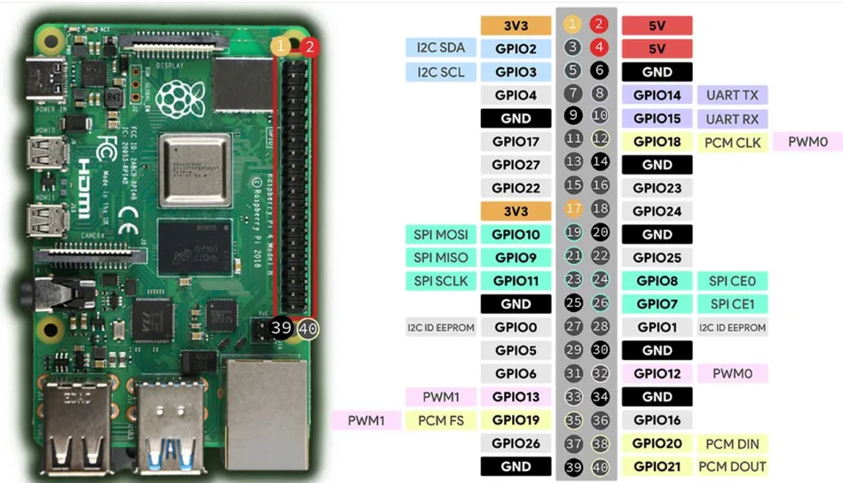
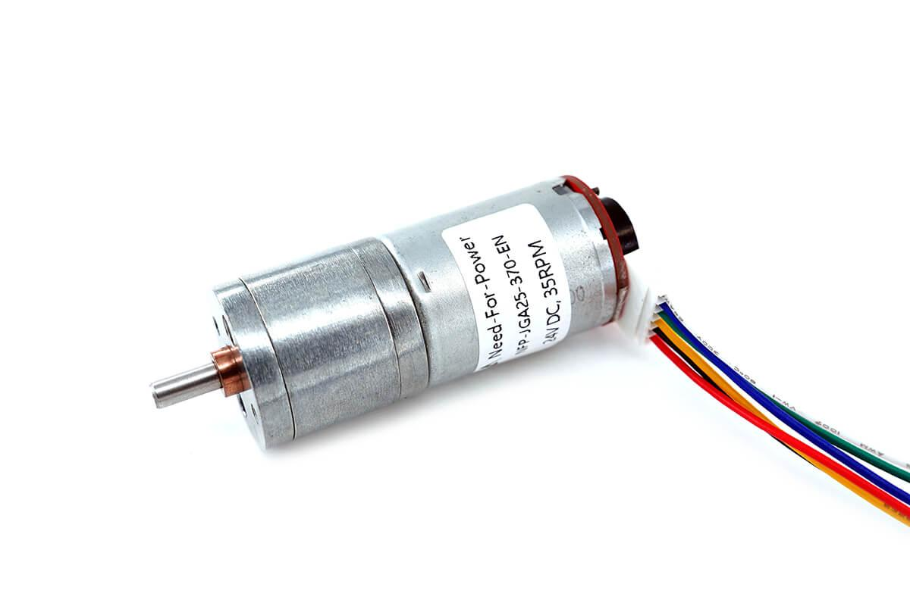
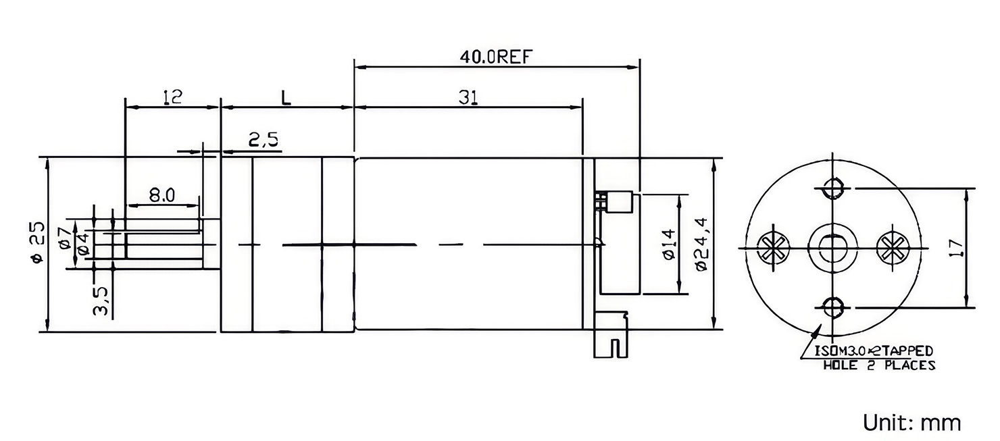
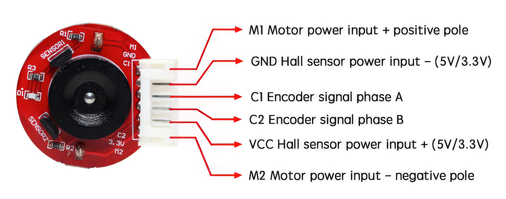
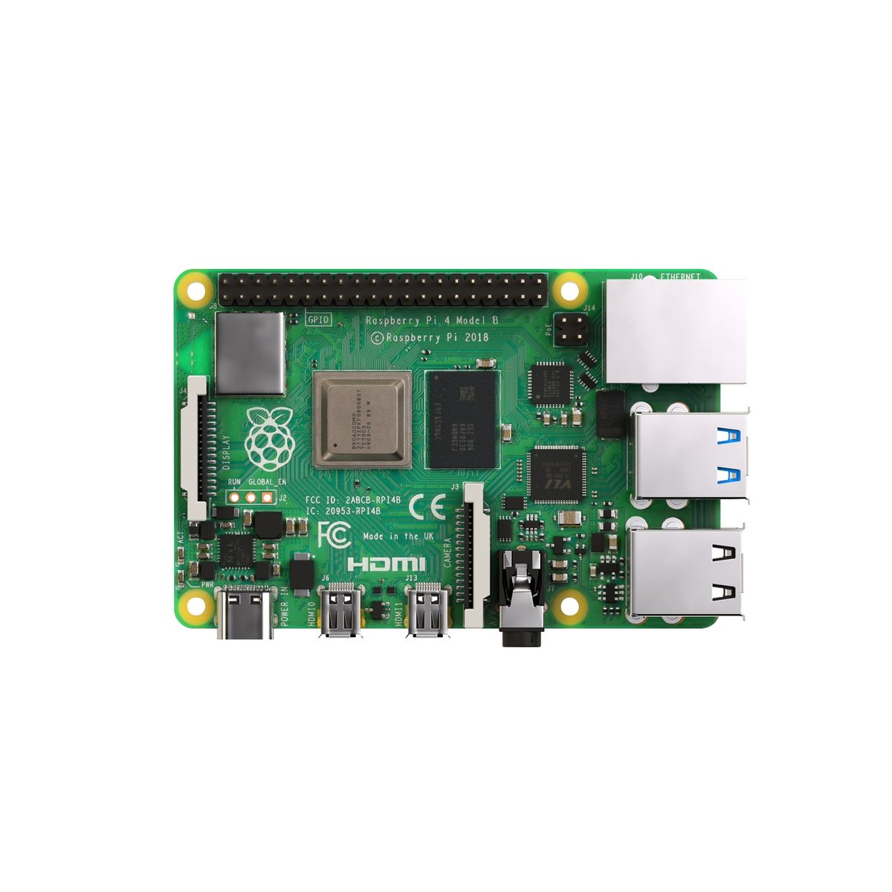
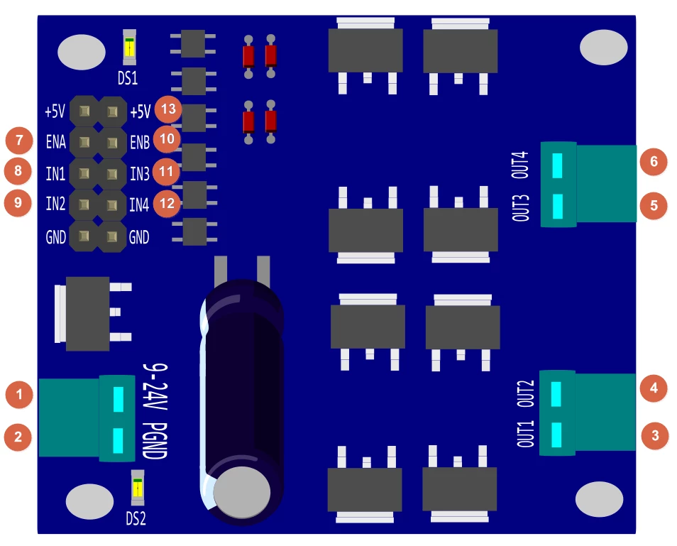

## Моя распиновка

### LEFT MOTOR
- **P3:** OUT3 + OUT4
- **ENB** → pin 33 / GPIO13
- **IN3** → pin 35 / GPIO19
- **IN4** → pin 37 / GPIO26

### RIGHT MOTOR
- **P4:** OUT1 + OUT2
- **ENA** → pin 32 / GPIO12
- **IN1** → pin 38 / GPIO20
- **IN2** → pin 40 / GPIO21

### MD LOGIC
- **3.3V** → pin 17
- **GND**  → pin 6

### RIGHT ENCODER
- **3.3V** → pin 1
- **GND**  → pin 9
- **A**    → pin 11 / GPIO17
- **B**    → pin 13 / GPIO27

### LEFT ENCODER
- **3.3V** → pin 1
- **GND**  → pin 14
- **A**    → pin 8 / GPIO14
- **B**    → pin 10 / GPIO15

### GPIO SCHEME
```text
[ENC_VCC]     3.3V (1) (2) 5V
             GPIO2 (3) (4) 5V
             GPIO3 (5) (6) GND [MD_GND]
             GPIO4 (7) (8) GPIO14 [L_ENC_A]
 [R_ENC_GND]   GND (9) (10) GPIO15 [L_ENC_B]
 [R_ENC_A]  GPIO17 (11) (12) GPIO18
 [R_ENC_B]  GPIO27 (13) (14) GND [L_ENC_GND]
            GPIO22 (15) (16) GPIO23
 [MD_VCC]     3.3V (17) (18) GPIO24
            GPIO10 (19) (20) GND
             GPIO9 (21) (22) GPIO25
            GPIO11 (23) (24) GPIO8
               GND (25) (26) GPIO7
             ID_SD (27) (28) ID_SC
             GPIO5 (29) (30) GND
             GPIO6 (31) (32) GPIO12 [R_ENA]
 [L_ENB]    GPIO13 (33) (34) GND
 [L_IN3]    GPIO19 (35) (36) GPIO16
 [L_IN4]    GPIO26 (37) (38) GPIO20 [R_IN1]
               GND (39) (40) GPIO21 [R_IN2]
```




---

## Еще одна схема подключения, собрал Claude

### Комплектующие

**Моторы**
- 25mm Metal Gear Motor NFP-GM25-370-EN × 2 — 34:1, 175rpm, 12V DC
  ([nfpshop](https://nfpshop.com/product/25mm-metal-gear-motor-model-nfp-jga25-370-en))





**Питание**
- RC Plus LiPo Sigma 45C-90C 2200 mAh 3S1P 11.1V, XT-60
- RC Plus Power Plus 60 Lipo Lader AC 60W (зарядка)
- Etronix 1-8S Lipo Battery Voltage Meter with Alarm (не обязательно)

**Электроника**
- Raspberry Pi 4 Model B 4GB
- Raspberry Pi Camera Module 3 Wide 12MP
- DFRobot DC-DC Adjustable Step-down Buck Converter 5A
- DC Motor Driver 2x7A



**Кабели и крепёж (не эти брать, просто для примера)**
- Силиконовый кабель 18AWG красный/чёрный (силовые линии)
- XT60U Connector Set × 2
- JST-XH 6p connector + cable + PCB × 4 (разъёмы моторов с энкодерами)
- DuPont Male-Female / Female-Female 30cm
- Rocker switch
- Alpha Wire single core Ø1.5mm 0.33mm² красный/чёрный
- M3 spacers, M3 threaded inserts, поворотные колёса / шаровые опоры W420, термоусадка

### Питание

```text
LiPo 3S 11.1V 2200mAh ──XT60──┬── balance ──→ Etronix Voltage Meter (alarm)
                              │
                        [Rocker switch]
                              │ 11.1V (18AWG)
              ┌───────────────┴───────────────┐
              ▼                               ▼
     Motor Driver 2x7A                 DFRobot Buck 5A
     (силовой вход VM/GND)                    │ 5V
       ├─ P4: OUT1/OUT2 → ПРАВЫЙ мотор        ▼
       └─ P3: OUT3/OUT4 → ЛЕВЫЙ мотор    Raspberry Pi 4 (5V)
```

Общая земля: GND драйвера (логика) ↔ pin 6 Raspberry Pi.

### Драйвер моторов



```text
Raspberry Pi 4                      Motor Driver 2x7A
pin 17  3.3V   ───────────────────→ VCC (логика)
pin 6   GND    ───────────────────→ GND (логика)

pin 32  GPIO12 ───────────────────→ ENA ┐
pin 38  GPIO20 ───────────────────→ IN1 ├─ P4: OUT1 + OUT2 → ПРАВЫЙ мотор
pin 40  GPIO21 ───────────────────→ IN2 ┘

pin 33  GPIO13 ───────────────────→ ENB ┐
pin 35  GPIO19 ───────────────────→ IN3 ├─ P3: OUT3 + OUT4 → ЛЕВЫЙ мотор
pin 37  GPIO26 ───────────────────→ IN4 ┘
```

### Энкодеры

```text
Raspberry Pi 4                      ПРАВЫЙ энкодер (JST-XH 6p)
pin 1   3.3V   ── синий   ────────→ VCC
pin 9   GND    ── чёрный  ────────→ GND
pin 11  GPIO17 ←─ зелёный ───────── A
pin 13  GPIO27 ←─ жёлтый  ───────── B

Raspberry Pi 4                      ЛЕВЫЙ энкодер (JST-XH 6p)
pin 1   3.3V   ───────────────────→ VCC
pin 14  GND    ───────────────────→ GND
pin 8   GPIO14 ←────────────────── A
pin 10  GPIO15 ←────────────────── B
```

### Камера

```text
Raspberry Pi 4  CSI ──шлейф──→ Camera Module 3 Wide
```

### Сводная таблица

| Узел            | Сигнал | Провод  | Pin | GPIO   |
|-----------------|--------|---------|----:|--------|
| Левый мотор     | ENB    |         |  33 | GPIO13 |
| Левый мотор     | IN3    |         |  35 | GPIO19 |
| Левый мотор     | IN4    |         |  37 | GPIO26 |
| Правый мотор    | ENA    |         |  32 | GPIO12 |
| Правый мотор    | IN1    |         |  38 | GPIO20 |
| Правый мотор    | IN2    |         |  40 | GPIO21 |
| Драйвер логика  | 3.3V   |         |  17 | —      |
| Драйвер логика  | GND    |         |   6 | —      |
| Правый энкодер  | 3.3V   | синий   |   1 | —      |
| Правый энкодер  | GND    | чёрный  |   9 | —      |
| Правый энкодер  | A      | зелёный |  11 | GPIO17 |
| Правый энкодер  | B      | жёлтый  |  13 | GPIO27 |
| Левый энкодер   | 3.3V   |         |   1 | —      |
| Левый энкодер   | GND    |         |  14 | —      |
| Левый энкодер   | A      |         |   8 | GPIO14 |
| Левый энкодер   | B      |         |  10 | GPIO15 |

### Примечания

- GPIO14/15 — это UART (TX/RX). Энкодер работает и так: `GPIO.setup()` при старте переключает пины в обычный вход.
  Рекомендация: выключить serial console (`raspi-config` → Interface → Serial), чтобы при загрузке Pi не слал логи в GPIO14, куда подключён выход энкодера.
